# 🚀 Cẩm Nang Quản Trị Dự Án Phần Mềm & Khởi Tạo Năng Suất (VinUni AI20K)
### Kinh Nghiệm Quản Trị Dự Án Thực Chiến & Nghệ Thuật Xử Lý Xung Đột Nhóm

> **Đơn vị phát hành:** VinUni & Ban Tổ Chức AI20K (Mentor Workshop)  
> **Tài liệu đào tạo chuyên đề:** Dành riêng cho các đội thi tham gia Chương Trình Tìm Kiếm Nhân Tài Thực Chiến A.I (AI20K)  
> **Thời lượng chương trình:** 6 tuần thực chiến (Build Phase)

---

## 🧭 Mục Lục Chuyên Đề
1. [Triết Lý Thực Thi Trong Thế Giới Thực (Execution Over Core Tech)](#1-triết-lý-thực-thi-trong-thế-giới-thực)
2. [Project Charter: La Bàn Định Hướng Dự Án Thành Công](#2-project-charter-la-bàn-định-hướng-dự-án-thành-công)
3. [Tam Giác Phân Định Vai Trò (PO - PM - Tech Lead)](#3-tam-giác-phân-định-vai-trò)
4. [Nguyên Tắc Quản Trị Nguồn Sự Thật Duy Nhất (Single Source of Truth)](#4-nguyên-tắc-nguồn-sự-thật-duy-nhất-ssot)
5. [Chiến Lược Phát Hành Liên Tục (Continuous Delivery & Release Often)](#5-chiến-lược-phát-hành-liên-tục)
6. [User Story: Đơn Vị Tiền Tệ Chung Của Dự Án Phần Mềm](#6-user-story-đơn-vị-tiền-tệ-chung)
7. [Kỷ Luật Sprint & 2 Điểm Checkpoint Sinh Tử (W3 & W5)](#7-kỷ-luật-sprint--2-điểm-checkpoint-sinh-tử)
8. [Quy Trình Viết Đặc Tả Kỹ Thuật (RFC: Motivation - Design - Plan)](#8-quy-trình-viết-đặc-tả-kỹ-thuật)
9. [Tối Ưu Hóa Cuộc Họp: Daily Standup vs Technical Meeting](#9-tối-ưu-hóa-cuộc-họp)
10. [Bốn Giai Đoạn Tâm Lý Nhóm (Mô Hình Tuckman)](#10-bốn-giai-đoạn-tâm-lý-nhóm-tuckman-model)
11. [Ma Trận Xử Lý Xung Đột: Kỹ Thuật vs Cá Nhân](#11-ma-trận-xử-lý-xung-đột)
12. [Nghệ Thuật Lắng Nghe Bài Bản: Bài Tập Sad - Mad - Glad](#12-nghệ-thuật-lắng-nghe-bài-bản-sad---mad---glad)
13. [Tinh Thần Liên Chức Năng (Cross-functional Teamwork)](#13-tinh-thần-liên-chức-năng)
14. [Lệnh Khởi Hành (Mission Brief Cho Sprint 1)](#14-lệnh-khởi-hành-mission-brief-sprint-1)

---

## 1. Triết Lý Thực Thi Trong Thế Giới Thực

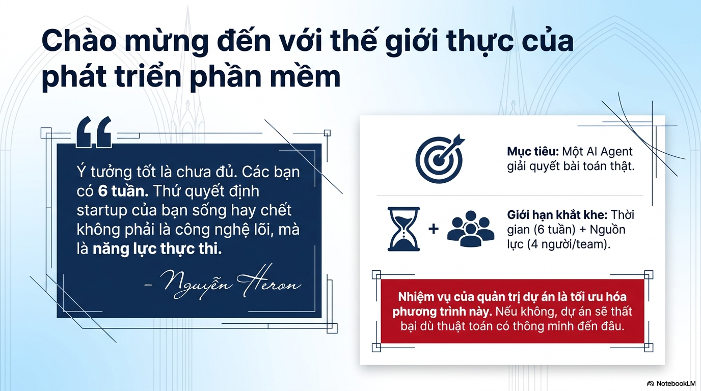

> *"Ý tưởng tốt là chưa đủ. Các bạn có 6 tuần. Thứ quyết định startup của bạn sống hay chết không phải là công nghệ lõi, mà là **năng lực thực thi**."*  
> — **Nguyễn Heron**

* **Mục tiêu tối thượng:** Xây dựng một **AI Agent hoàn chỉnh giải quyết bài toán thật**.
* **Giới hạn khắt khe (Constraints):**
  * **Thời gian:** Đúng 6 tuần thực chiến.
  * **Nguồn lực:** 4 thành viên / nhóm.
* **Nhiệm vụ cốt lõi:** Quản trị dự án sinh ra để tối ưu hóa phương trình giữa thời gian và nguồn lực. Nếu buông lỏng quản trị, dự án chắc chắn sẽ thất bại dù thuật toán AI có thông minh đến đâu.

---

## 2. Project Charter: La Bàn Định Hướng Dự Án Thành Công

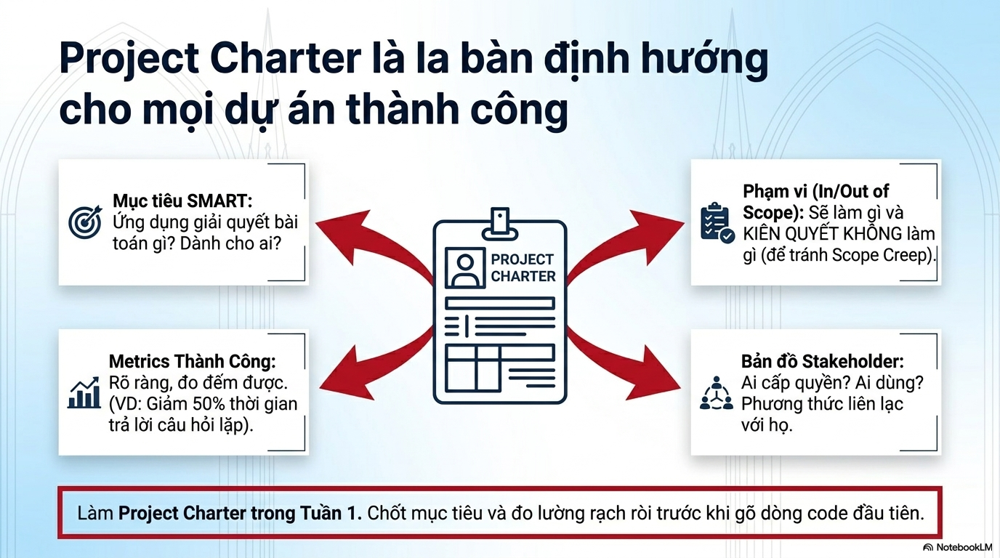

Mỗi đội thi bắt buộc phải hoàn thành bản **Project Charter** ngay trong **Tuần 1**, chốt mục tiêu và tiêu chí đo lường rạch ròi trước khi gõ bất kỳ dòng code nào:

1. **Mục tiêu SMART:** Ứng dụng giải quyết bài toán gì cụ thể? Dành cho ai (User Persona)?
2. **Phạm vi Ranh giới (In-Scope / Out-of-Scope):**
   - Xác định rõ sẽ làm gì trong 6 tuần.
   - **KIÊN QUYẾT KHÔNG LÀM GÌ** để triệt tiêu hội chứng phình phạm vi (*Scope Creep*).
3. **Metrics Thành Công (Success Metrics):** Chỉ số đo lường định lượng rõ ràng (ví dụ: Giảm 50% thời gian xử lý, chặn 95% kịch bản lừa đảo, PII masking 100%).
4. **Bản Đồ Stakeholder:** Ai cấp dữ liệu? Ai là người dùng cuối? Mentor là ai? Phương thức liên lạc và khung giờ làm việc chung.

---

## 3. Tam Giác Phân Định Vai Trò

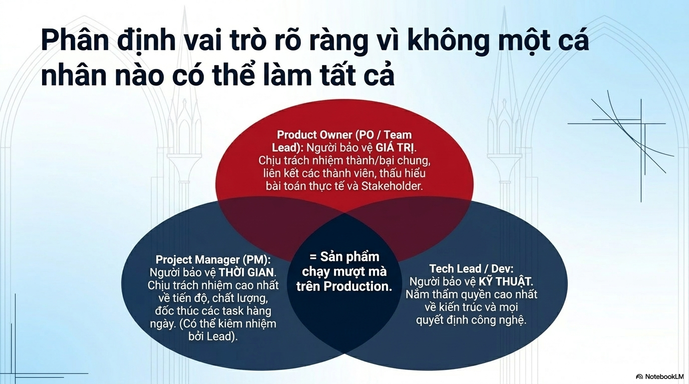

Không một cá nhân nào có thể tự gánh vác toàn bộ dự án. Ba trụ cột trách nhiệm phải được phân định dứt khoát:

* **Product Owner (PO / Team Lead) — Người bảo vệ GIÁ TRỊ:**  
  Chịu trách nhiệm tối cao về thành bại chung của sản phẩm, kết nối các thành viên, thấu hiểu sâu sắc bài toán nghiệp vụ thực tế và kỳ vọng của Stakeholder/Ban Giám Khảo.
* **Project Manager (PM) — Người bảo vệ THỜI GIAN:**  
  Chịu trách nhiệm cao nhất về tiến độ, chất lượng, đôn đốc các đầu việc hàng ngày (Daily tasks), cảnh báo sớm rủi ro chậm trễ. *(Có thể do Team Lead kiêm nhiệm)*.
* **Tech Lead / Dev — Người bảo vệ KỸ THUẬT:**  
  Nắm thẩm quyền cao nhất về kiến trúc hệ thống, lựa chọn công nghệ, thiết kế API và chất lượng mã nguồn.

> 🎯 **Điểm giao thoa cốt lõi:** Sự phối hợp nhịp nhàng của 3 vai trò này tạo ra: **Sản phẩm chạy mượt mà trên Production thật.**

---

## 4. Nguyên Tắc Nguồn Sự Thật Duy Nhất (SSOT)

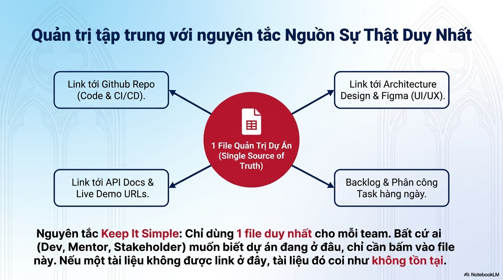

* **Nguyên tắc "Keep It Simple":** Chỉ sử dụng **DUY NHẤT 1 FILE QUẢN TRỊ DỰ ÁN** (Google Sheet Template hoặc tài liệu trung tâm) cho mỗi đội thi.
* **Bốn liên kết bắt buộc phải quy về một mối:**
  1. Link tới GitHub Repository (Mã nguồn, Pull Requests, CI/CD Actions).
  2. Link tới Thiết kế Kiến trúc (Architecture Diagrams) & Bản vẽ UI/UX Figma.
  3. Link tới Tài liệu API Docs & Các đường dẫn chạy thử (Live Demo URLs).
  4. Bảng tính Backlog & Phân công nhiệm vụ chi tiết hàng ngày.
* **Quy luật bất biến:** *Bất cứ ai (Dev, Mentor, Stakeholder, BTC) muốn biết dự án đang ở đâu, chỉ cần bấm vào file này. Nếu một tài liệu hoặc tính năng không được liên kết tại đây, nó được coi như **KHÔNG TỒN TẠI**.*

---

## 5. Chiến Lược Phát Hành Liên Tục

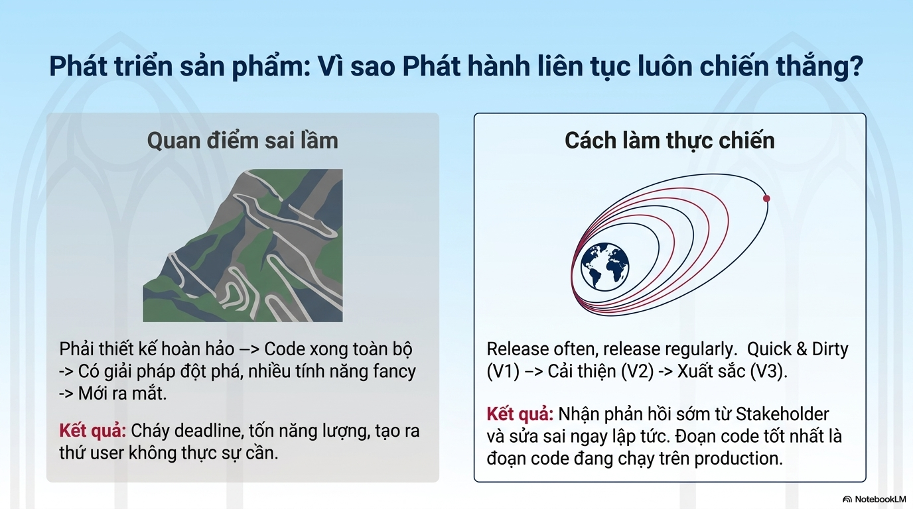

* **Cái bẫy tai hại:** Cố gắng thiết kế hoàn hảo -> Ngồi code âm thầm toàn bộ hệ thống -> Ôm đồm các tính năng hào nhoáng (fancy) -> Đợi đến sát ngày mới ra mắt.  
  *Hậu quả:* Cháy deadline, cạn kiệt năng lượng, làm ra thứ mà người dùng và giám khảo không hề cần.
* **Tư duy thực chiến thắng thế:** **Release often, release regularly.**  
  * Lần 1: **Quick & Dirty (V1)** — Chạy được luồng cốt lõi dù giao diện còn thô.
  * Lần 2: **Cải thiện (V2)** — Tối ưu hóa hiệu năng, xử lý lỗi ngoại lệ.
  * Lần 3: **Xuất sắc (V3)** — Hoàn thiện trải nghiệm, mượt mà trên môi trường thật.
* **Châm ngôn:** *Đoạn code tốt nhất là đoạn code đang chạy ổn định trên Production và có phản hồi thực tế từ người dùng.*

---

## 6. User Story: Đơn Vị Tiền Tệ Chung

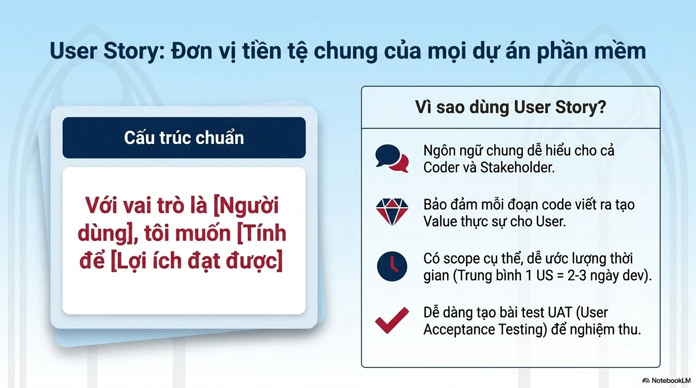

Mọi tính năng trong Backlog đều phải được diễn đạt theo cấu trúc User Story chuẩn:

$$\text{"Với vai trò là [Người dùng], tôi muốn [Tính năng] để [Lợi ích đạt được]"}$$

* **Lợi ích thực tế:**
  * Là ngôn ngữ trung gian giúp Lập trình viên, Team Lead và Mentor hiểu chung một ý.
  * Bảo đảm mỗi dòng code viết ra đều phục vụ một giá trị người dùng cụ thể.
  * Phạm vi công việc rõ ràng, dễ ước lượng thời gian (Trung bình 1 User Story = 2 - 3 ngày phát triển).
  * Là căn cứ trực tiếp để thiết lập kịch bản kiểm thử nghiệm thu (UAT - User Acceptance Testing).

---

## 7. Kỷ Luật Sprint & 2 Điểm Checkpoint Sinh Tử

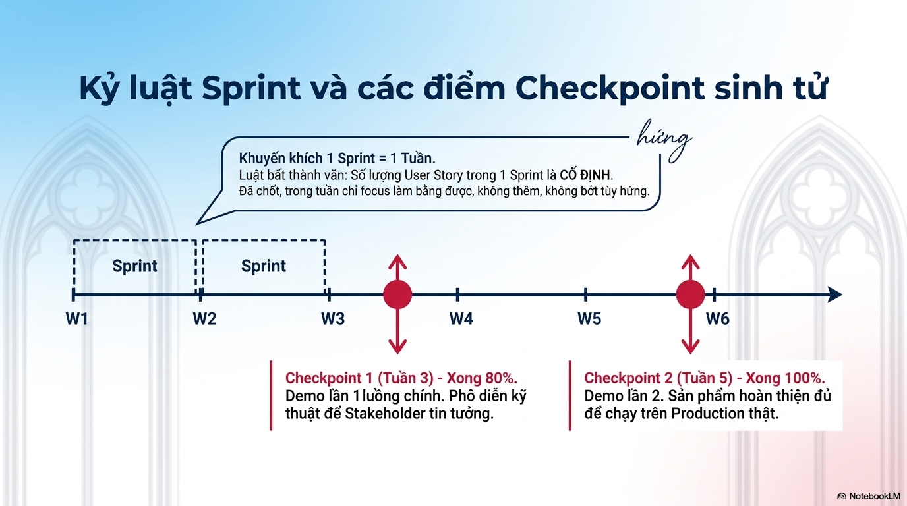

* **Quy ước Sprint:** Khuyến khích chia nhịp độ **1 Sprint = 1 Tuần**.
* **Nguyên tắc "Cố định phạm vi" (Scope Frozen):** Số lượng User Story đã chốt vào đầu Sprint là **CỐ ĐỊNH**. Cả nhóm tập trung giải quyết dứt điểm, tuyệt đối không tùy tiện nhồi nhét hay cắt bỏ tính năng theo cảm hứng cá nhân.
* **Hai Điểm Checkpoint Sinh Tử trên lộ trình 6 tuần:**
  * **Checkpoint 1 (Cuối Tuần 3) — Hoàn thành 80%:** Demo lần 1 luồng chính (End-to-End happy path). Phô diễn năng lực kỹ thuật và giải pháp kiến trúc để củng cố niềm tin với Mentor và Stakeholder.
  * **Checkpoint 2 (Cuối Tuần 5) — Hoàn thành 100%:** Demo lần 2. Sản phẩm hoàn thiện toàn diện, chịu tải tốt, sẵn sàng bàn giao cho Demo Day tuần 6.

---

## 8. Quy Trình Viết Đặc Tả Kỹ Thuật (Tech Spec)

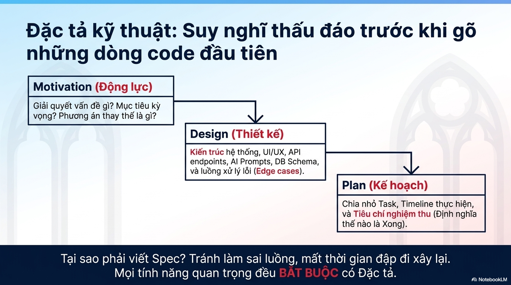

Quy trình 3 bước bắt buộc trước khi lập trình bất kỳ module phức tạp nào:

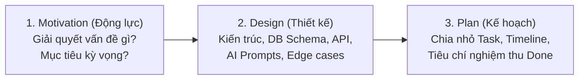

> **Tại sao phải viết Spec?** Để suy nghĩ thấu đáo, thống nhất luồng dữ liệu giữa Frontend và Backend, tránh tuyệt đối tình trạng "code xong rồi đập đi xây lại".

---

## 9. Tối Ưu Hóa Cuộc Họp: Daily Standup vs Technical Meeting

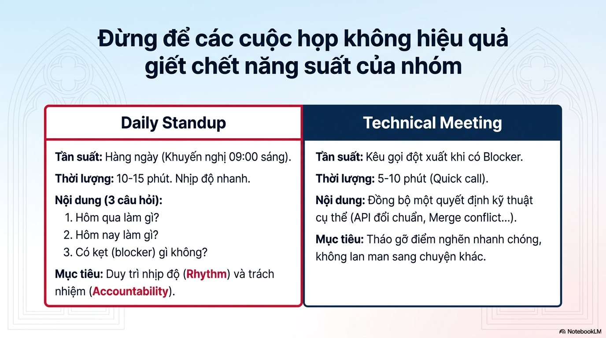

| Tiêu Chí | Daily Standup (Họp giao ban ngày) | Technical Meeting (Họp giải quyết kỹ thuật) |
|---|---|---|
| **Tần suất** | Hàng ngày (Khuyến nghị đúng 09:00 sáng) | Kêu gọi đột xuất ngay khi phát sinh điểm nghẽn (Blocker) |
| **Thời lượng** | 10 - 15 phút (Nhịp độ nhanh, đứng họp) | 5 - 10 phút (Quick call tập trung) |
| **Nội dung** | **Trả lời đúng 3 câu hỏi:** 1. Hôm qua đã hoàn thành gì? 2. Hôm nay sẽ làm gì? 3. Đang gặp khó khăn/kẹt (blocker) ở đâu? | Thống nhất 1 quyết định kỹ thuật cụ thể (Thay đổi schema DB, chuẩn API, xung đột git merge) |
| **Mục tiêu** | Duy trì nhịp độ (Rhythm) và tính chịu trách nhiệm (Accountability) | Tháo gỡ nút thắt tức thì, tuyệt đối không lan man |

---

## 10. Bốn Giai Đoạn Tâm Lý Nhóm (Tuckman Model)

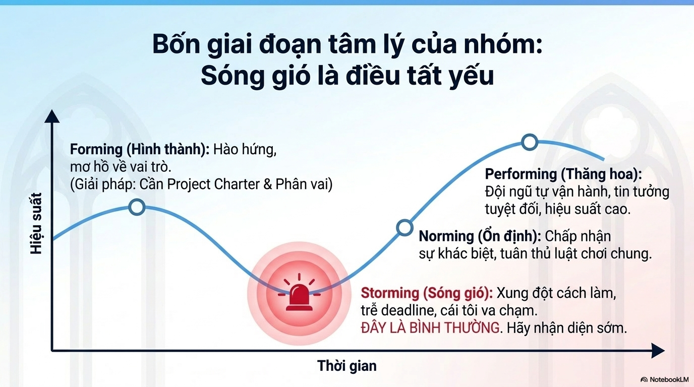

Quá trình phát triển tâm lý của nhóm thi đấu 6 tuần trải qua 4 chặng:
1. **Forming (Hình thành):** Các thành viên hào hứng, nhưng còn mơ hồ về vai trò và cách phối hợp.  
   *(Giải pháp: Cần chốt ngay Project Charter & Phân công vai trò rạch ròi).*
2. **Storming (Sóng gió / Đáy đồ thị):** Bắt đầu xảy ra bất đồng về giải pháp kỹ thuật, trễ hạn bàn giao, va chạm cái tôi.  
   *(Nhận thức: ĐÂY LÀ HIỆN TƯỢNG HOÀN TOÀN BÌNH THƯỜNG. Cần nhận diện sớm và đối thoại chuyên nghiệp để vượt qua).*
3. **Norming (Ổn định):** Chấp nhận sự khác biệt của từng cá nhân, đồng lòng tuân thủ kỷ luật và luật chơi chung.
4. **Performing (Thăng hoa):** Đội ngũ tự vận hành trơn tru, tin tưởng lẫn nhau tuyệt đối, tốc độ bứt phá thần tốc.

---

## 11. Ma Trận Xử Lý Xung Đột

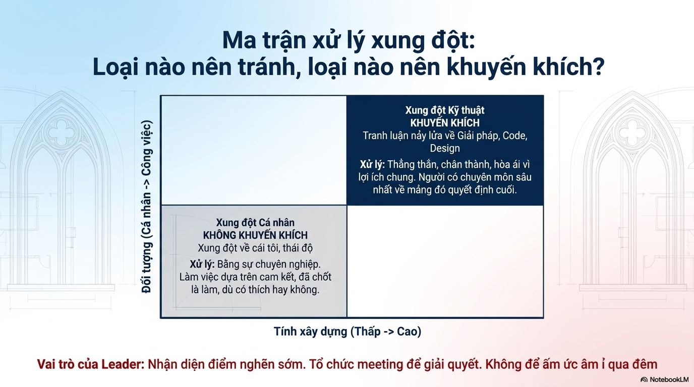

Phân loại xung đột theo 2 trục: Đối tượng (Cá nhân $\leftrightarrow$ Công việc) và Tính xây dựng (Thấp $\leftrightarrow$ Cao):

* **Xung đột Kỹ thuật (Công việc & Tính xây dựng cao) $\rightarrow$ KHUYẾN KHÍCH:**  
  Tranh luận nảy lửa, quyết liệt về kiến trúc, cấu trúc code, thiết kế giao diện.  
  *Nguyên tắc xử lý:* Thẳng thắn, chân thành, hòa ái vì mục tiêu chung. Người có chuyên môn sâu nhất về mảng đó giữ quyền ra quyết định cuối cùng.
* **Xung đột Cá nhân (Cái tôi, thái độ & Không xây dựng) $\rightarrow$ KIÊN QUYẾT TRIỆT TIÊU:**  
  *Nguyên tắc xử lý:* Tách biệt cảm xúc bằng sự chuyên nghiệp. Làm việc dựa trên cam kết; một khi nhóm đã biểu quyết và chốt phương án, tất cả phải đồng lòng thực hiện dù cá nhân có thích hay không.

> 👑 **Vai trò của Team Leader:** Luôn là người phát hiện sớm các điểm nghẽn tâm lý, chủ động tổ chức trao đổi thẳng thắn, **tuyệt đối không để sự ấm ức âm ỉ qua đêm.**

---

## 12. Nghệ Thuật Lắng Nghe Bài Bản: Sad - Mad - Glad

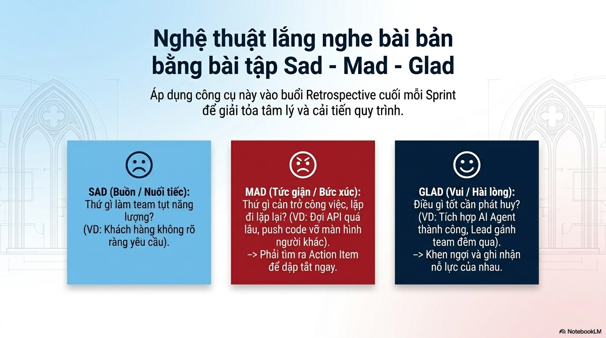

Thực hành vào cuối mỗi Sprint trong buổi **Retrospective** để giải tỏa năng lượng tiêu cực và cải tiến quy trình:

* 😢 **SAD (Buồn / Nuối tiếc):** Điều gì diễn ra trong tuần làm cả đội tụt năng lượng? *(Ví dụ: Yêu cầu của đề bài chưa rõ, thiếu dữ liệu thử nghiệm)*.
* 😡 **MAD (Bức xúc / Cản trở):** Điều gì lặp đi lặp lại cản trở công việc chung? *(Ví dụ: Chờ API quá lâu, commit code không test làm vỡ giao diện của nhau)*.  
  $\rightarrow$ **Bắt buộc phải tìm ra Hành động Cụ thể (Action Item) để khắc phục ngay trong Sprint tới.**
* 😊 **GLAD (Hài lòng / Tự hào):** Điều tích cực nào đã làm được? *(Ví dụ: Tích hợp thành công luồng LangGraph, đồng đội thức đêm hỗ trợ nhau)*.  
  $\rightarrow$ **Khen ngợi chân thành và ghi nhận nỗ lực của từng cá nhân.**

---

## 13. Tinh Thần Liên Chức Năng

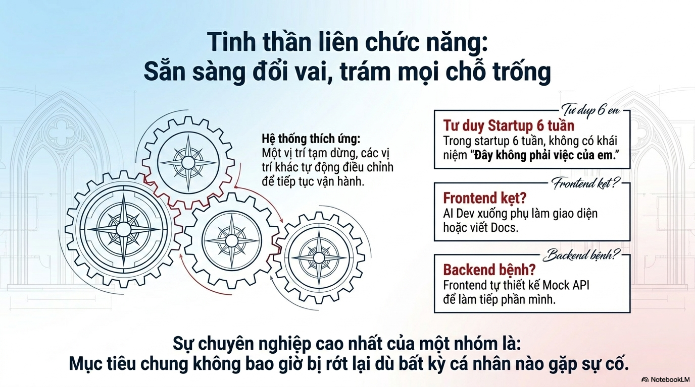

* **Tư duy Startup 6 tuần:** Trong một cuộc đua nước rút, **không bao giờ tồn tại khái niệm: "Đây không phải là việc của tôi".**
* **Cơ chế thích ứng linh hoạt (Gear Mesh System):**
  * Khi Frontend bị kẹt giao diện $\rightarrow$ AI / Backend Dev sẵn sàng xắn tay xuống hỗ trợ CSS hoặc viết tài liệu kỹ thuật.
  * Khi Backend gặp sự cố $\rightarrow$ Frontend chủ động tạo Mock API để tiếp tục hoàn thiện giao diện mà không phải ngồi chờ.
* **Chuẩn mực chuyên nghiệp tối cao:** *Mục tiêu chung của nhóm không bao giờ được phép rớt lại phía sau dù bất kỳ cá nhân nào gặp trở ngại.*

---

## 14. Lệnh Khởi Hành (Mission Brief Cho Sprint 1)

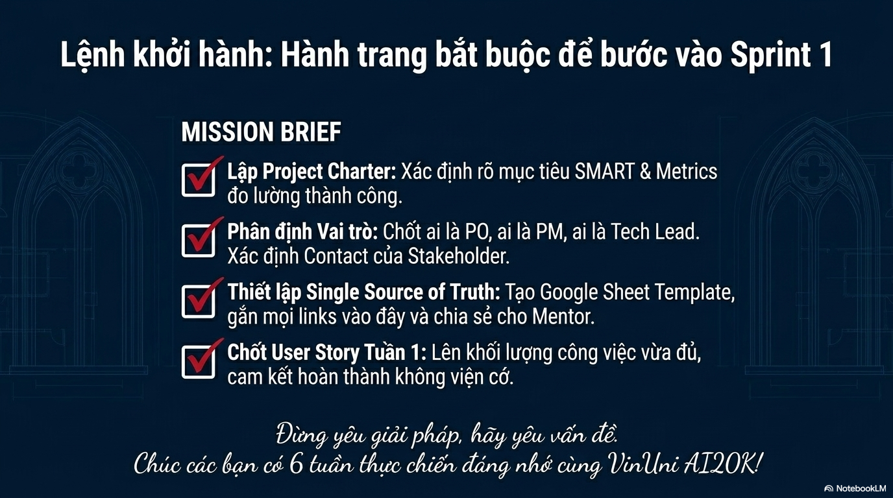

Bốn hành trang bắt buộc của mọi đội thi trước khi bắt đầu Sprint 1:

- [x] **1. Lập Project Charter:** Xác định dứt khoát bài toán, mục tiêu SMART và các chỉ số thành công.
- [x] **2. Phân định Vai Trò:** Chốt rõ ràng ai là PO, ai là PM, ai là Tech Lead; nắm kênh liên lạc của Mentor và Stakeholder.
- [x] **3. Thiết lập Nguồn Sự Thật Duy Nhất (SSOT):** Khởi tạo bảng tính Quản trị Dự án, gắn toàn bộ liên kết tài nguyên và cấp quyền cho Mentor.
- [x] **4. Chốt User Story Sprint 1:** Lựa chọn khối lượng công việc vừa đủ cho tuần đầu tiên, cam kết hoàn thành với tinh thần không viện cớ.

> 🌟 *"Đừng chỉ yêu giải pháp của mình, hãy say mê giải quyết vấn đề của người dùng. Chúc đội thi có 6 tuần thực chiến đáng nhớ!"*
